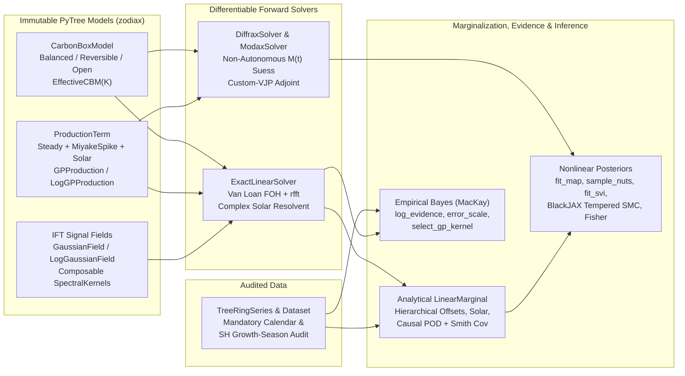

# ticktack

**Differentiable carbon box modelling, Information Field Theory production reconstruction, and Bayesian radiocarbon inference in JAX.**

[](https://doi.org/10.21105/joss.05084)
[](https://arxiv.org/abs/2205.07512)
[](https://github.com/SharmaLlama/ticktack/blob/main/LICENSE)

`ticktack` models the transport of cosmogenic radiocarbon ($^{14}\text{C}$) through atmospheric, biospheric, and marine reservoirs and solves the Bayesian inverse problem of reconstructing cosmic-ray production histories $Q(t)$ from tree-ring $\Delta^{14}\text{C}$ time series. Originally developed to characterize rapid solar energetic particle excursions (Miyake events; [Zhang et al. 2022](https://doi.org/10.1098/rspa.2022.0497); [Sharma et al. 2023](https://doi.org/10.21105/joss.05084)), **`ticktack 2.0`** is a complete, ground-up architectural redesign built on [`zodiax`](https://github.com/LouisDesdoigts/zodiax) / [`equinox`](https://github.com/patrick-kidger/equinox) immutable PyTrees, exact linear-time-invariant (LTI) matrix-exponential solvers, analytical Gaussian marginalization, [`virgil`](https://github.com/benjaminpope/virgil)-style Information Field Theory (IFT), Fisher information geometry, and gradient-based Bayesian inference in [`NumPyro`](https://num.pyro.ai/) and [`BlackJAX`](https://blackjax-devs.github.io/blackjax/).

---

## Architecture Overview



### Key Capabilities in `ticktack 2.0`

- **Composable `zodiax` PyTree carbon box models**: Flow-balanced (`BalancedCBM`), detailed-balance (`ReversibleCBM`), open sediment-burial (`OpenCBM`), fixed (`FixedCBM`), minimal canonical (`EffectiveCBM(K)`), and Fisher-subspace (`SubspaceCBM`) parametrizations, alongside audited literature presets (`Guttler15`, `Brehm21`, `Miyake17`, `Buntgen18`).
- **Exact LTI & non-autonomous ODE solvers**: `ExactLinearSolver` propagates piecewise-linear forcing via $(n+2)\times(n+2)$ Van Loan first-order-hold (FOH) matrix exponentials with causal `rfft` convolution, exact sub-annual spike quadrature, and complex frequency-domain solar resolvents $(i\omega I_n - A)^{-1}\mathbf{b}$ – eliminating the 2000-year numerical burn-in required in `ticktack 1.x`. `DiffraxSolver` and `ModaxSolver` integrate time-varying carbon-cycle trajectories $M_c(t)$ (industrial Suess dilution and geomagnetic modulation).
- **Analytical linear marginalization & causal POD**: `LinearMarginalConfig` marginalizes global Holocene offsets, per-laboratory calibration offsets, harmonic solar quadrature amplitudes, linear trends, and Solin–Särkkä Hilbert-space Gaussian-process modes (including stationary pre-history reservoir covariance via 24-step Smith doubling) in closed form, collapsing tens of linear nuisance dimensions out of MCMC.
- **Information Field Theory & automatic GP kernel discovery**: `ticktack.fields` implements 1D reflecting-boundary (orthonormal DCT-II) `GaussianField` and `LogGaussianField` priors with composable spectral kernels (`MaternSpectrum`, `SquaredExpSpectrum`, `QuasiPeriodicSpectrum`, `SumSpectrum`, `CorrelatedFieldSpectrum`), MacKay marginal evidence (`log_evidence`), laboratory uncertainty auditing (`error_scale`), and empirical-Bayes kernel selection (`select_gp_kernel`).
- **Fisher information geometry & Bayesian model comparison**: `cbm_fisher_spectrum` and `relaxation_fisher_modes` quantify the diffusive $\pi / \cosh(\pi\omega_{\ln})$ singular-value decay of carbon-cycle transfer rates (e.g. yielding $d_{\text{eff}} = 3.16$ and $I = 6.40\text{ bits}$ for 22-box `Brehm21` on the 28-series, 313-ring bundled `775CE` compilation under an assumed fiducial log-rate prior width `prior_cbm_sd = 0.35`), paired with `BlackJAX` adaptive tempered Sequential Monte Carlo (`sample_smc`) yielding asymptotically unbiased thermodynamic log-evidences $\ln \widehat{Z} \pm \widehat{\sigma}_{\ln Z}$.
- **Audited calendar & hemispheric growth conventions**: Mandatory calendar tags (`astronomical_ce`, `cal_bp`, `historical_bce` with astronomical year-zero correction) and explicit Boreal vs Austral tree-ring growth bounds (`schulman_start`, `end_year`, `explicit_bounds`).

---

## Where to Start

| Goal | Guide |
| :--- | :--- |
| Run forward simulations, MAP + NUTS/SMC Miyake fits, and IFT reconstructions | [Quickstart](quickstart.md) |
| Walk through the executed five-cell MWE Jupyter notebooks | [Tutorials](tutorials.md) |
| Understand governing LTI equations, decay constants, $R_{\text{ref}}$, and SH ring dating | [Physical & Calendar Conventions](conventions.md) |
| Learn how Van Loan FOH propagation, solar resolvents, and Perron–Frobenius CBMs work | [Solvers & Carbon Box Models](solvers_and_cbms.md) |
| Explore Laplace singular-value decay, `EffectiveCBM(K)`, and tempered SMC evidence | [Fisher Information & EffectiveCBMs](fisher_and_effective_cbm.md) |
| Reconstruct non-parametric $Q(t)$ via causal POD or DCT-II IFT fields and MacKay evidence | [Gaussian Processes & Information Field Theory](gp_and_ift.md) |
| Inspect bundled Miyake-event and IntCal20 datasets and provenance audits | [Bundled Datasets](data.md) |
| Upgrade `ticktack 1.x` scripts (`SingleFitter`, `MultiFitter`, `Miyake17`) to `2.0` | [Migrating from v1 to v2](migration.md) |
| Look up class signatures, parameters, and return types | [API Reference](api/index.md) |

---

## Installation

`ticktack 2.0` requires **Python $\ge 3.11$** and enables 64-bit JAX (`jax_enable_x64 = True`) automatically on import.

### Standard Installation (`pip` or `uv`)

```bash
pip install ticktack
```

For development from source (recommended with [`uv`](https://docs.astral.sh/uv/)):

```bash
git clone https://github.com/SharmaLlama/ticktack.git
cd ticktack
uv venv --python 3.12
uv pip install -e ".[dev]"
```

### Optional Extras

- **`ticktack[dev]`**: Installs `pytest`, `ruff`, and `jupyter` for running the test suite and notebooks.
- **`ticktack[cuda]`**: Installs CUDA 12 JAX wheels (`jax[cuda12]`) on Linux GPU hosts.
- **`ticktack[legacy]`**: Installs `astropy` when converting legacy unit quantities alongside `ticktack 1.x` workflows.

### Running the Test Suite

```bash
pytest
ruff check src tests
```

---

## Contributors & Citation

`ticktack` was created by **Utkarsh Sharma**, **Qingyuan Zhang**, **Jordan Dennis**, and **Benjamin Pope**.

If you use `ticktack` in published research, please cite both the methodology paper and the JOSS software paper:

- Zhang, Q., Sharma, U., Dennis, J. A., Scifo, A., Kuitems, M., Büntgen, U., Owens, M. J., Dee, M. W., & Pope, B. J. S. (2022). *Modelling cosmic radiation events in the tree-ring radiocarbon record*. Proceedings of the Royal Society A, 478(2266), 20220497. [doi:10.1098/rspa.2022.0497](https://doi.org/10.1098/rspa.2022.0497)
- Sharma, U., Zhang, Q., Dennis, J. A., & Pope, B. J. S. (2023). *ticktack: A Python package for carbon box modelling*. Journal of Open Source Software, 8(84), 5084. [doi:10.21105/joss.05084](https://doi.org/10.21105/joss.05084)

```bibtex
@article{Zhang2022,
  author  = {Zhang, Qingyuan and Sharma, Utkarsh and Dennis, Jordan A. and Scifo, Andrea and Kuitems, Margot and B{\"u}ntgen, Ulf and Owens, Mathew J. and Dee, Michael W. and Pope, Benjamin J. S.},
  title   = {Modelling cosmic radiation events in the tree-ring radiocarbon record},
  journal = {Proceedings of the Royal Society A},
  volume  = {478},
  number  = {2266},
  pages   = {20220497},
  year    = {2022},
  doi     = {10.1098/rspa.2022.0497}
}

@article{Sharma2023,
  author  = {Sharma, Utkarsh and Zhang, Qingyuan and Dennis, Jordan A. and Pope, Benjamin J. S.},
  title   = {ticktack: A Python package for carbon box modelling},
  journal = {Journal of Open Source Software},
  volume  = {8},
  number  = {84},
  pages   = {5084},
  year    = {2023},
  doi     = {10.21105/joss.05084}
}
```

## Licence & Name

`ticktack` is free software released under the [MIT Licence](https://github.com/SharmaLlama/ticktack/blob/main/LICENSE). Its name is a play on the Malvina Reynolds song [*Little Boxes*](https://www.youtube.com/watch?v=XUwUp-D_VV0) (*"little boxes made of ticky-tacky"*) and the steady ticking of the tree-ring radiocarbon clock.
